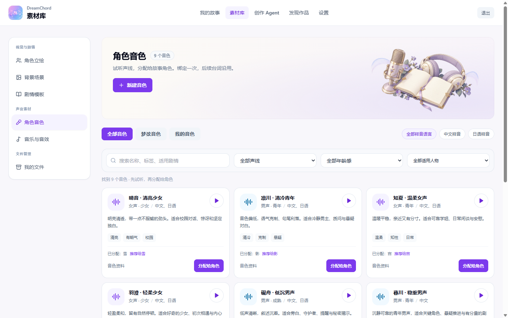
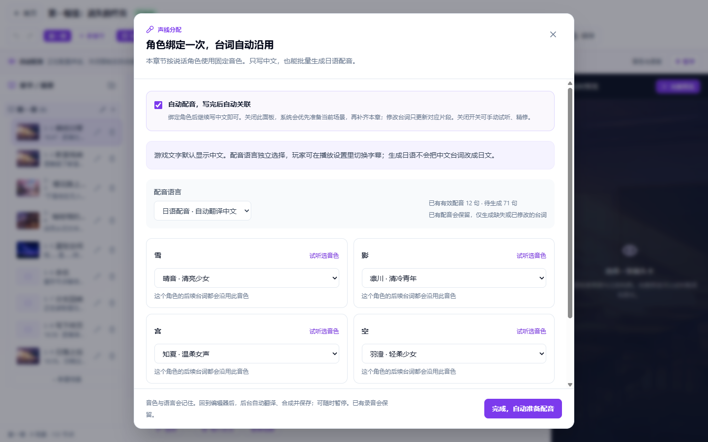
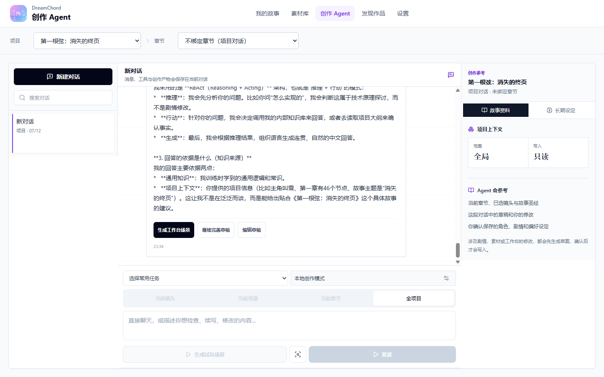

# 梦弦 DreamChord

面向视觉小说创作者的本地故事工房。用章节、场景和镜头卡组织剧情，试听音色后绑定角色，开启自动配音继续写作；中文显示与中日配音独立选择。背景、立绘、音乐、分支试玩和可审核的创作 Agent 都在同一个工作台里。

[在线项目展示](https://tl66666.github.io/DreamChord/) | [新手入门](docs/GETTING_STARTED.md) | [项目概览](docs/PROJECT_OVERVIEW.md) | [维护与迭代手册](docs/MAINTAINER_PLAYBOOK.md) | [完整文档](docs/README.md)

当前远端构建状态请查看 [GitHub Actions](https://github.com/tl66666/DreamChord/actions)：Actions 会保留历史失败记录，请以最新提交的 CI 与项目展示页部署结果为准。


## 声音库是怎样融入创作的

**试听声线 → 分配到故事角色 → 开启自动配音 → 继续写中文 → 预览已保存的对白。**



音色按特征命名，附适用人物、可用语言、来源与现有绑定。绑定一次后，后续对白沿用角色声线。编辑器停笔约 2.2 秒后会优先准备当前场景，再补齐本章；自动翻译、合成、关联并保存。新台词仍需合成，但作者不必逐句点生成。有效结果可复用，改一句只更新对应片段，也能暂停、重试或切到手动精修。



游戏文字默认中文，日语配音不会把中文台词改掉。自动处理发生在编辑器打开期间；公开播放器使用已保存的音频。内置五个角色的双语合成声线、部分示例音轨与 13 首 TERNOX CC0 配乐，未宣称全剧情已预录。展示页可直接试听两条有来源记录的合成样音。

[完整声音工作流](docs/VOICE_WORKFLOW.md) · [本机引擎安装](docs/GPT_SOVITS_SETUP.md) · [当前开发交接](docs/CURRENT_HANDOFF.md)

## 这个项目解决什么问题

普通文本编辑器适合写正文，却不擅长维护角色出场、背景切换、选择分支和素材引用；纯节点编辑器能表达结构，但长篇写作成本高。DreamChord 把两种工作方式合在一起：

```text
章节 -> 场景 -> 镜头卡 -> 分支检查 -> 完整预览 -> 发布
                   |
                   +-> Agent 理解项目、检查问题、提出修改
                   +-> 素材库提供立绘、背景、CG 和音频
```

作者主要在镜头卡里写作，节点图用于检查结构。新镜头会继承上一镜头的背景和在场角色；只有明确设置登场、更新或退场，舞台状态才会改变。分支独立计算状态，避免另一条路线的人物或背景串入当前剧情。

## 核心能力

- **故事工作台**：章节、场景、对话、旁白、心理、回忆、系统提示、选项、跳转和分支汇合。
- **舞台连续性**：继承背景和在场角色，显示登场、保持、更新、退场的最终结果。
- **可视化检查**：剧情流程图、断路与死路检测、实时场景预览和完整试玩。
- **创作 Agent**：多对话、章节可选绑定、分层记忆、项目上下文、工具调用、提案审核、应用与撤销。
- **全局素材库与音频演出**：一次上传的立绘、背景、CG、BGM、音效和配音可跨故事复用；独立音乐库支持按情绪、风格、剧情场景筛选，记录循环方式与授权来源，镜头卡可手动绑定 BGM、一次性音效和台词/旁白配音。
- **角色声音库与自动配音**：授权参考录音组成可复用音色，先试听、再绑定；本机管理 GPT-SoVITS / CosyVoice3，后台按角色准备对白，支持中文输入、日语配音、暂停重试与手动精修。
- **图片准备**：检查真实图片内容，保留原图，生成白底去除、透明裁边、立绘、CG 和背景候选。
- **可靠保存**：串行自动保存、版本冲突保护、50 步撤销与重做、项目备份与恢复。
- **本地优先**：故事、数据库和上传文件默认保存在本机；基础编辑不需要模型 API Key。

## Agent 为什么是项目特色

DreamChord Agent 不是悬浮在编辑器旁的通用聊天框。它知道当前项目、故事圣经、角色、素材、章节、场景、剧情健康状态和作者确认过的记忆。



Agent 根据任务选择三种执行方式：

| 方式 | 适用情况 | 是否修改数据 |
|---|---|---|
| 本地即时回答 | 问候、时间、能力说明、下一步建议 | 否 |
| 只读对话 | 创作讨论、项目分析、普通知识问题 | 否 |
| 受控行动 | 明确的剧情改写或素材处理 | 先生成提案，作者确认后才修改 |

没有选择章节时也可以正常聊天和讨论整部作品。需要把修改写入故事时，再绑定具体章节。即使外部模型返回格式异常，普通文字回答仍会保留；Agent 不会因为模型误发剧情补丁而把简单问题标记为任务失败。

### 不配置与配置 API Key 的行为

| 状态 | 可以直接完成 | 适合的任务 |
|---|---|---|
| 未配置 API Key | 项目/章节/素材盘点、剧情体检、创作知识问答、确定性续写草稿、正文结构化转换、素材提示词、角色逐句配音计划 | 快速梳理故事，把用户或 Agent 已有正文转换为可审核的场景、旁白、角色台词和选项 |
| 已配置兼容模型 | 上述全部能力，以及更自然的长文续写、对白润色、开放式改写和剧情规划 | 需要较强语言表达与多轮创作讨论时 |

无 Key 并不是“无法使用 Agent”。本地助手优先完成可以确定的项目任务；配置模型只增强开放式表达。两种模式都遵循同一条安全路径：**草稿或正文 → 结构化解析 → 补丁预览 → 作者确认 → 写入工作台 → 可撤销**。转换只复用项目中精确匹配的背景与角色，未匹配素材不会被随意套用。

[查看 Agent 使用指南](docs/AGENT_GUIDE.md) | [查看 Agent 架构与安全边界](docs/ARCHITECTURE.md#创作-agent)

## Windows 一键启动

准备环境：Windows 10/11、Node.js 20 或更高版本。首次运行需要联网安装锁定版本的依赖。

1. 下载或克隆完整仓库。
2. 双击根目录的 `start-dreamchord.bat`。
3. 等待前后端健康检查通过，浏览器会自动打开。
4. 使用演示账号登录：`demo / demo123`。

启动器支持中文、空格路径和重复双击。它会保留已有 `.env`、密钥和数据路径，在数据库结构同步前创建备份，并在 DreamChord 已运行时直接复用当前服务。

环境诊断：

```powershell
powershell -ExecutionPolicy Bypass -File .\scripts\doctor.ps1
```

完整安装说明和常见故障处理见 [新手入门](docs/GETTING_STARTED.md)。

声音库支持 GPT-SoVITS 克隆和 CosyVoice3 情感配音，输入新台词可自动建议情绪与节奏。模型在后台运行，试听与角色绑定都在项目内完成。安装与真实台词自检见 [声音库与配音](docs/GPT_SOVITS_SETUP.md)。

官方示例现提供中日双语文本、独立字幕/配音语言切换，以及五个角色的双语合成声线。游戏文字默认中文；选择日语配音时仍只需输入中文，系统会自动翻译。编辑器“角色配音”可绑定固定音色、为本章节缺失台词批量生成、集中试听并自动关联，也可单句重录。修改台词后，过期配音会静音提示。音乐库包含 13 首有来源记录的 TERNOX CC0 原声，声音和音乐资料都可编辑管理。

## 技术栈

| 层 | 技术 |
|---|---|
| Web | React 18、TypeScript、Vite、Zustand、React Flow |
| API | Node.js、Express、TypeScript、Zod |
| 数据 | Prisma、SQLite |
| 媒体 | Sharp |
| 测试 | Vitest、Testing Library、Supertest |
| 工作区 | pnpm workspace |

## 仓库结构

```text
apps/web                 前端、故事编辑器、Agent、素材库和播放器
apps/server              API、认证、Agent 服务、素材处理和 Prisma 数据层
packages/story-domain    前后端共享的剧情图、补丁和健康检查规则
scripts                  一键启动、环境诊断、数据备份和发布就绪检查
docs                     使用、产品、架构、维护文档与真实项目截图
source-assets            官方演示使用的源素材
```

## 适合不同读者的入口

| 你是谁 | 建议先看 |
|---|---|
| 第一次使用 | [新手入门](docs/GETTING_STARTED.md) |
| 想创作完整故事 | [创作者工作流](docs/CREATOR_WORKFLOW.md) |
| HR、老师或项目评审 | [项目概览](docs/PROJECT_OVERVIEW.md) |
| 开发者或接手维护者 | [系统架构](docs/ARCHITECTURE.md) |
| 想参与开发 | [贡献指南](CONTRIBUTING.md) |
| 准备发布新版本 | [发布指南](docs/RELEASE_GUIDE.md) |
| 第一次接手维护或迭代 | [维护与迭代手册](docs/MAINTAINER_PLAYBOOK.md) |
| 查看版本变化 | [变更记录](CHANGELOG.md) |
| 不理解项目术语 | [术语表](docs/GLOSSARY.md) |

全部专题文档见 [文档中心](docs/README.md)。

## 开发与验证

所有命令都从仓库根目录执行：

```bash
corepack enable
corepack prepare pnpm@9.1.0 --activate
pnpm install --frozen-lockfile
pnpm lint
pnpm test
pnpm build
pnpm test:readiness
pnpm test:presentation
```

当前自动化测试覆盖剧情规则、分支舞台状态、保存冲突、Agent 路由与记忆隔离、工具调用、剧情补丁、图片处理、备份恢复和核心界面流程。高风险交互还需要使用真实浏览器检查桌面与移动布局、控制台错误和失败请求。

Windows 开发服务运行时，`pnpm test` 的准备步骤可能因 Prisma 引擎 DLL 已加载而报 `EPERM`。已有 Client 可用且没有修改 schema 时，可用 `pnpm -r test` 验证所有工作区；需要重新生成 Client 时先正常停止后端，再执行准备命令。不要删除 DLL、数据库或上传目录来绕过占用。

## 当前边界

- 无 API Key 时仍可使用项目检索、对话/记忆回顾、创作知识解释、公共知识只读查询、确定性续写草稿和正文结构化转换；更自然的开放式长文续写、润色和复杂改写建议配置外部模型。
- 白底或纯色背景适合本地规则抠图，复杂真实背景仍建议先用专业分割工具处理。
- 当前是本地单用户工作台，不包含多人实时协作、在线付费 TTS、GPT-SoVITS 权重训练工作台、波形剪辑、口型同步或完整多轨 BGM 时间线；已支持内置引擎安装脚本、后台启停、私有声音库、零样本试听生成、确认入库，以及镜头级 BGM/音效/配音。
- Agent 不能访问任意 shell、文件系统或数据库，所有写入都经过业务工具、校验和作者确认。

后续方向见 [项目路线图](docs/ROADMAP.md)。

## 许可证

[MIT](LICENSE)
